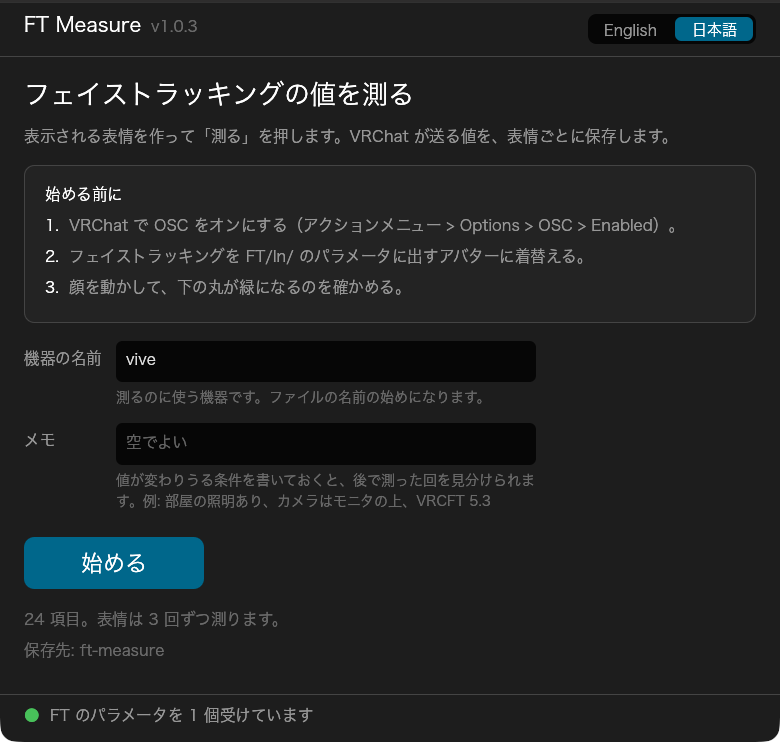
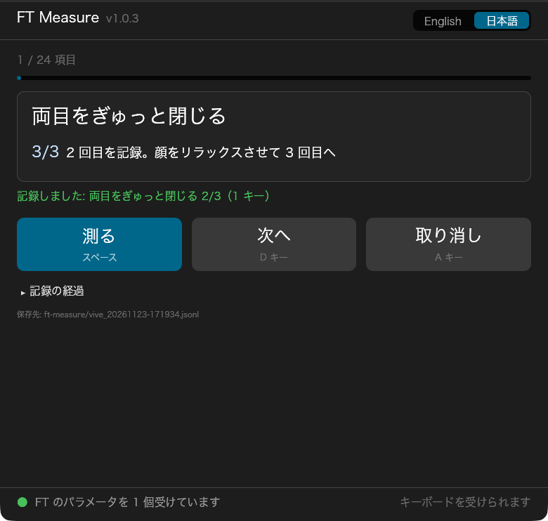

# FT Measure 説明書

FT Measure（ft-measure）は、VRChat のフェイストラッキング（FT）の値を、表情ごとに測って記録のファイルに書く Windows のアプリです。この説明書は、FT Measure の zip に入れて配っている日本語の説明書です。英語の説明は、リポジトリの README（https://github.com/kmnk/ft-measure ）にあります。

記録は、FT の設定を作る Unity のツール Face Tracking Generator（FTG）で読めます。FTG の使い方は、FTG の説明書（https://github.com/kmnk/VRChat_FaceTrackingGenerator/blob/main/docs/manual-ja/README.md ）にあります。

## はじめに

### 何を測るか

VR の機器とデスクトップ（VRChat の Selfie Expression）では、同じ顔をしても FT の値の出方が違うことがあります。FT Measure は、ウィンドウに出る表情（目を閉じる、口を開ける、口角を上げるなど）を順に作り、そのときの FT のキーの値を記録します。項目はアプリに組み込みで、変えられません。どの記録も同じ項目を持つので、機器どうしや人どうしで比べられます。

### 記録を FTG でどう使うか

記録を FTG の設定エディタの Devices タブに読ませると、測った顔ごとに、どのキーがどのくらい動くかが見えます。FTG で、State に入る Transition の条件（どのキーがいくつを超えたら入るか）を決めるときの参考にします。記録は見るためのもので、FTG の出力は変わりません。

## 動作環境

- Windows 10 か 11（64 ビット）
- PC 版の VRChat（OSC をオンにする）
- 測定用アバター（FTMeasureAvatar）に着替えられること（「[測定用アバターに着替える](#測定用アバターに着替える)」）
- VR の機器を測るときは、VRChat のネイティブ FT に値を送る VRCFaceTracking（Steam 版の 2026-11-02 の更新「Avalonia Update」以降。Steam 版は自動で更新されます）

## 開き方

1. zip を、プログラムを置くフォルダ（デスクトップや `Documents` の下など）に展開します。`Program Files` の下は書き込めないので避けてください
2. 展開したフォルダの `ft-measure.exe` をダブルクリックします

FT Measure の exe にはコード署名がありません。初めて開くとき、Windows が「Windows によって PC が保護されました」と出すことがあります。そのときは「詳細情報」を押し、「実行」を押すと開きます。開くかどうかは、ご自身の判断と責任でお願いします。

ウィンドウの右上で、表示を日本語か英語に切り替えられます。選んだ言語は次に開いたときも使われます。

## 測定用アバターに着替える

FT Measure は、VRChat が OSC で送るアバターのパラメータのうち、`FT/In/` で始まるものを記録します。ふつうのアバターはこのパラメータを出さないので、測るときは測定用アバターに着替えます。

- 測定用アバター: FTMeasureAvatar（https://vrchat.com/home/avatar/avtr_112d1877-a76d-442f-820d-41d34d402898 ）

このアバターは、FT の 102 のキーをすべて `FT/In/<キーの名前>` のパラメータに出します。測るためのアバターなので、測り終えたら元のアバターに戻ってください。

## 測る手順

### 始める前に

1. VRChat で OSC をオンにします（アクションメニュー > Options > OSC > Enabled）
2. 測定用アバターに着替えます
3. 測っている間は chatbox に項目が出て、同じインスタンスの人にも見えます。気になるときは Private のインスタンスで測ります
4. VR の機器を測るときは VRCFaceTracking を、デスクトップを測るときは Selfie Expression を有効にします

### 測る

1. FT Measure のウィンドウで、顔を動かして、ウィンドウの下の丸が緑になるのを確認します。緑にならないときは「[困ったとき](#困ったとき)」を見てください
2. **機器の名前** に機器の名前（例 `vive`、`selfie`）を、**メモ** に覚え書きを入れます（メモは空でよい）
3. **始める** を押します
4. ウィンドウと chatbox に出る表情を作り、**測る**（スペースキー）を押します。表情ごとに 3 回測ります。測る間に顔を一度ゆるめ、もう一度表情を作ってください
5. 3 回測ったら **次へ**（D キー、→、Enter）で次の項目に進みます。間違えたら **取り消し**（A キー、←、Backspace）で、今の項目の最後の 1 回を消せます
6. 全部の項目を測ると、「測定が終わりました」と出ます

キーは、FT Measure のウィンドウが選ばれているときだけ効きます。選ばれていないと、ウィンドウに「キーボードを使うには、このウィンドウをクリック」と出ます。操作のたびに音が鳴ります。

項目の種類によって、測り方が少し違います。

- 表情: 表情を作って **測る** を押します。3 回測ります
- 順に作る表情（視線の上・下・右・左など）: chatbox に出る向きに顔を動かし、止めて **測る** を押します。向きを 3 周します
- 読み上げ: **測る** で区間を始め、ウィンドウと chatbox に出る文を読み、もう一度 **測る** で止めます

VR の機器とデスクトップの両方を使うときは、それぞれで測ります。FTG は、VR の記録とデスクトップの記録を 1 つずつ読めます。

### 途中でやめる

ウィンドウを閉じると止まります。それまでに測った分は、記録のファイルに残ります。

## 記録のファイル

記録は、exe の隣の `ft-measure` フォルダに、`<機器の名前>_<日時>.jsonl` の 1 つのファイルで書かれます。測るたびに書き直すので、途中で閉じても測った分は残ります。**フォルダを開く** で、このフォルダを開けます。

ファイルの中身は英語の JSON Lines です。1 行目に、ファイルの形式のバージョン（`format_version`）、機器の名前、メモ、始めた日時が入り、続く行に 1 回の測定ごとの全部のキーの値が入ります。各行には項目の `id`（`eyes_close` など）が入ります。

## 記録を FTG に読ませる

FTG の設定エディタの **Devices** タブで、**Add VR recording** か **Add Desktop recording** を押し、記録のファイルを選びます。読み方は、FTG の説明書の「VR とデスクトップで分ける」の節（https://github.com/kmnk/VRChat_FaceTrackingGenerator/blob/main/docs/manual-ja/README.md#vr-とデスクトップで分ける ）にあります。

## 画面ごとの説明

ウィンドウのタイトルは **FT Measure** です。

### 始める前の画面

| 名前 | 何をするか |
| --- | --- |
| フェイストラッキングの値を測る | 始める前の画面の見出し |
| 始める前に | 測る前にすることの一覧。OSC をオンにする、測定用アバターに着替える、顔を動かして下の丸が緑になるのを確認する |
| 機器の名前 | 記録のファイルの名前の頭に付く名前。空のときは **例 selfie、vive** と出ます |
| メモ | 記録に残す覚え書き。空のときは **空でよい** と出ます |
| 保存先 | 記録を書くフォルダ |
| 始める | 測り始めます。値が届く前に始めてもかまいません |
| 下の丸 | FT の値を受けているかを出します。緑なら受けています。受けていないときは **受けていません**、始めた後に届かないときは **VRChat からの FT の値を待っています** と出ます |

### 測っている間の画面

| 名前 | 何をするか |
| --- | --- |
| 済み / 記録済み | 測り終えた項目と、区間を記録した読み上げに付く印 |
| 測定で始める / 記録中 測定で止める | 読み上げの区間の状態。「測る」で区間を始め、もう一度で止めます |
| 測る | 今の値を記録します。読み上げでは区間の開始と終わり。ボタンの下に **スペース** と、押すキーが出ます |
| 次へ | 測り終えた項目から次へ進みます。ボタンの下に **D キー** と出ます。読み上げを記録していないと **測定で区間を記録してから次へ進めます** と出ます |
| 取り消し | 今の項目の最後の 1 回を消します。ボタンの下に **A キー** と出ます |
| 記録の経過 | 開くと、**項目**（項目の数）、**書き出し先**（記録を書くファイル）、測った回数、区間の開始・終わり、取り消しなどの経過が出ます |
| 保存先 | 記録のファイルの場所 |

### 終わった後の画面

| 名前 | 何をするか |
| --- | --- |
| 全部の項目を測りました | 終わった後の画面の見出し。測っている間の画面と chatbox には **測定が終わりました** と出ます |
| 保存したファイル | 書いた記録のファイル |
| フォルダを開く | 記録のフォルダを開きます |
| 閉じる | ウィンドウを閉じます |

## 困ったとき

### 下の丸が緑にならない

- VRChat で OSC がオンになっているか見てください（アクションメニュー > Options > OSC > Enabled）
- 測定用アバターに着替えているか見てください。ふつうのアバターは `FT/In/` のパラメータを出しません
- 顔を動かしてください。値が変わらないと届きません
- 他のアプリが OSC のポート 9001 を使っていると、FT Measure は受けられず「127.0.0.1:9001 は他のアプリが使っています。」で始まる文が出ます（ほかの理由で受けられないときは「OSC を受けられません」と出ます）。そのアプリを閉じるか、`ft-measure.exe --port <番号>` で別のポートを使い、VRChat の OSC の送り先をそれに合わせてください

### アバターが変わったと出る

- 測っている途中でアバターを着替えると、「アバターが変わりました。それまでの値を捨てました」と出て、その時点の値を捨てます。測定用アバターのまま測ってください

### ウィンドウが開かない

- 「Windows によって PC が保護されました」と出たら、「詳細情報」→「実行」で開きます（「[開き方](#開き方)」）

## 問い合わせとライセンス

### 問い合わせ

不具合の報告と問い合わせは、BOOTH のメッセージか、GitHub の Issues（https://github.com/kmnk/ft-measure/issues ）で受けます。返事ができないこともあります。VRCFaceTracking と FT の機器の設定、Windows の SmartScreen や対策ソフトの設定には対応しません。

### ライセンスと無保証

FT Measure は MIT と Apache-2.0 のどちらかを選べるライセンスです（zip の `LICENSE-MIT` と `LICENSE-APACHE`）。無保証で、作者は使ったことで生じた損害の責任を負いません。使うかどうかは、ご自身の判断と責任でお願いします。
